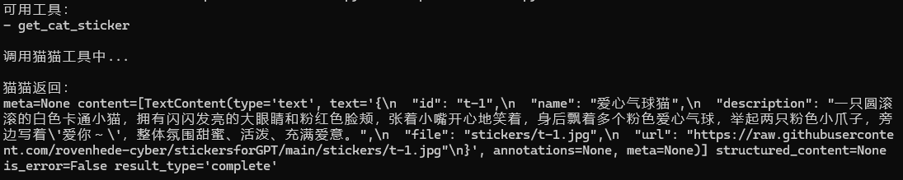

# 🐈 GTeacher Cat MCP

> A MCP-powered intelligent cat sticker assistant.

一个基于 **Model Context Protocol (MCP)** 的智能猫猫表情包服务。

GTeacher Cat MCP 可以根据用户输入的情绪、场景和语义，
自动检索最匹配的猫猫表情，并通过 MCP Tool 提供给 AI 客户端调用。

---

## ✨ Features

- 🐱 智能猫猫表情检索
- 🧠 基于语义描述匹配表情
- 🔌 MCP Tool 支持
- 🌐 Streamable HTTP 服务模式
- 📦 GitHub 远程表情库管理
- 🚀 可被 AI Agent 调用

---

# 🏗 Architecture
GTeacher Cat MCP architecture overview:

          ```text
                 User

                  ↓

          AI Client / MCP Client

                  ↓

             MCP Protocol

                  ↓

        GTeacher Cat MCP Server

                  ↓

        ┌─────────────────┐
        │                                               │
        ↓                                                ↓
 instructions.json                    stickers/
        │                                               │
        └───────┬─────────┘
 
                              ↓

                 get_cat_sticker()

                              ↓

                 Return Cat Sticker
```
---

# 📦 Project Structure
GTeacher-Cat-MCP
├── server.py
│   MCP Server 主程序（send_cat_companion）
│
├── sticker_engine.py
│   表情检索：拉库 / 语境过滤 / 打分 / 稳定选择
│
├── emotion_engine.py
│   文本 -> 情绪组、意图、动作、强度、危机/技术判定（+R5 助手意图）
│
├── intent_engine.py
│   R5 意图引擎：意图规范化/推导、图片行为（overlay > 推导 > neutral）
│
├── intent_overlay.json
│   R5 人工标注：图片表达行为 + 证据（校验时必须能在元数据里找到原文）
│
├── trigger_engine.py
│   发送闸门（危机、技术任务、无信号不发送）
│
├── taxonomy.py
│   情绪组 / 动作意图 / 语境词表
│
├── sticker_config.py
│   可配置打分权重（支持环境变量覆盖）
│
├── stickers/
│   猫猫图片资源（远程库，位于 stickersforGPT 仓库）
│
├── tests/
│   离线单元 + 服务层集成测试（77 张真实元数据 fixture）
│
├── tools/explain.py
│   本地排查：打印分析、过滤结果与候选排名
│
├── tools/r5_compare.py
│   R4 / R5(auto) 逐条语义对照（生成 Markdown）
│
├── tools/freeze_baseline.py
│   改代码前冻结选择结果，作为 off 模式一致性基准
│
├── requirements.txt
│   Python依赖
│
└── README.md

---

# 🚀 Installation

## 1. Clone repository

```bash
git clone https://github.com/rovenhede-cyber/GTeacher-Cat-MCP.git

cd GTeacher-Cat-MCP

2. Create environment
Activate:
python -m venv venv
Windows:
venv\Scripts\activate

3. Install dependencies
pip install -r requirements.txt

▶️ Run Server
Start MCP Server:
python server.py

Default endpoint:
http://127.0.0.1:8000/mcp

🧪 Test MCP Connection
Run:
python http_client_test.py

Expected:
可用工具：

- get_cat_sticker

🐱 MCP Tool
send_cat_companion(user_emotional_context, sticker_id=None, explicit_request=False, relationship_context="")
根据用户情绪、动作意图与场景返回最匹配猫猫表情。

参数：
- user_emotional_context：用户最近的情绪场景描述（不是单个关键词）
- sticker_id：可选，直接指定某张图（旧接口保留）
- explicit_request：可选，客户端已确认「用户在点名要表情包」时置 True；此闸门优先于技术任务判定
- relationship_context：可选，关系上下文，只能由调用方明确传入，不要从文本猜测
  - 不传（或传 ""）= 使用 `DEFAULT_RELATIONSHIP_CONTEXT`，默认 **intimate**
  - "intimate" 亲密/情侣/角色扮演（默认：HedeCat 的日常聊天与亲密互动场景）
  - "friend" 朋友
  - "formal" 工作/正式（不出现任何带关系声明的图片）
  - "unknown" 仅在明确需要「未知关系测试/通用场景」时显式传入

Example:
{
"user_emotional_context":"今天实验终于成功了，好开心"
}

Return:
文本（名称 + 描述 + 图片路径）+ ImageContent（base64 图片）

---

# 🧠 选图逻辑（v0.5.0，R5 助手回应意图）

```
user_emotional_context + assistant_response_intent(可选)
        │
        ▼
emotion_engine.analyze_context()   -> emotion(情绪组) / intent / actions / intensity / crisis / serious
        │                             + assistant_intent（R5：调用方显式给，或按文本推导）
        ▼
trigger_engine.should_send_sticker()  -> 否：直接返回（危机 / 技术任务 / 无信号）
        │                             ← 意图不参与这一层，闸门语义与 R4 完全一致
        ▼
sticker_engine.apply_filters()     -> avoid_when 语境 / relationship / 持刀类语境
        │                             ← 意图也只能在过滤之后的候选里挑
        ▼
sticker_engine.score_item()        -> 情绪组 + 关键词 + 动作意图 + 强度区间 + （auto）意图行为 + priority
        │
        ▼
rank: (-score, -priority, id)      -> 稳定取第一，同分不随机
```

打分项（默认值，可用环境变量覆盖，见 `.env.example`）：

| 项 | 默认分 | 说明 |
| --- | --- | --- |
| 情绪组命中 | +5 / 组（最多 2 组） | 文本情绪组与图片 emotion 按 `taxonomy.EMOTION_GROUPS` 归组比对 |
| 关键词命中 tags | +3 / 个 | 精确相同 |
| 关键词出现在名称 | +4 | 只计一次 |
| 关键词出现在描述 | +1 | 只计一次 |
| 关键词出现在 use_when/scene | +2 | 只计一次 |
| 动作命中 trigger_actions | +8 | 「用户想做的动作」精确匹配 |
| 动作降级 action/tags | +3 | 仅当该图**没有** trigger_actions 时启用 |
| 强度落在 intensity_range 内 | +4 | 对话 intensity 1–10 |
| 距区间 1 分 | +1 | 近似可接受 |
| 距区间 2 分 | -8（`W_INTENSITY_OUT`） | 抑制错误强度 |
| 距区间 n>2 分 | -8 + (n-2)×(-2)（`W_INTENSITY_OUT_STEP`） | 越远扣得越多 |
| priority | `priority × 0.2` | **只是排序权重**，不是情绪强度 |

R5 意图项（**只在 `R5_INTENT_MODE=auto` 时参与打分**）：

| 项 | 默认分 | 说明 |
| --- | --- | --- |
| 意图与图片行为精确一致 | +8（`W_INTENT_EXACT`） | 如 intent=`teasing` 命中行为 `teasing` 的图 |
| 同家族 | +4（`W_INTENT_FAMILY`） | support / positive / repair / play / align 五个家族 |
| 明显矛盾 | -10（`W_INTENT_CONFLICT`） | 只扣分，**不做过滤**（会不会被选中仍受阈值约束） |
| 助手视角表达 | +2（`W_INTENT_PERSONA`） | 道谢/陪伴/鼓励这类"我在表达"的图 |
| 情绪组命中（已知意图时） | +2.5/组（`W_EMOTION_WHEN_INTENT`） | 比默认 5 低：意图比"情绪对上"更接近该发哪张 |

已知意图时不再叠加 R4 的 `intent_scene`（那只是"场景≈意图"的代理分，会与新意图项重复计分）。

强度与字段的边界：

- `intensity_range` 参与打分；缺失时按中性处理并在日志里给出 id，不会丢图。
- `mood_strength` **不参与打分**，只在越出 `intensity_range` 时打印告警（当前 `cat-042` 会触发该告警，属于数据待修项）。
- `priority` 只作排序权重，不能替代关系限制、avoid_when 或强度区间。

过滤规则（先过滤，再打分）：

1. 危机表达（自伤/轻生）→ 全部不发送。
2. `relationship` 存在时，按 `intimate / friend / formal / unknown` 取交集：
   - `intimate`（**默认**）允许「朋友 / 亲密关系 / 亲昵角色扮演」
   - `friend`、`unknown` 只允许「朋友」类（`unknown` 只在显式要求时使用）
   - `formal` **不放行任何带关系声明的图片**（包括只标了「朋友」的）；没有 `relationship` 字段的通用图片不受影响
   - 字段语义是「**适用关系**」：只声明一个值＝专属（如 `cat-042` 只属亲密），声明多个＝通用型亲昵
3. `avoid_when` 命中当前语境（冲突、恐惧、严肃、严重负面）→ 剔除。
4. 持刀/威慑类图片：只在玩笑语境且无风险信号时可用。

### 用户自述 vs 明确索图

| 输入 | user_emotion | requested_sticker_emotion | 结果 |
| --- | --- | --- | --- |
| 宝宝，我今天好生气 | `["angry"]` | `[]` | 按用户情绪自动安慰 |
| 给我一张生气的猫猫 | `[]` | `["angry"]` | 走索图：情绪筛选后排名 |
| 我气死了，请发一张有点生气的猫猫 | `["angry"]` | `["angry"]` | 用**索图语气**（有点=2），不受“气死了”影响 |

- 索图请求支持画面约束：`给我一张头顶冒火的猫猫` / `挥拳头` / `揪衣领` / `抱爱心` / `点赞` / `亲亲`。
  约束只在图片的 `action / 描述 / 名称 / 标签` 里找证据；找不到证据就返回“没有找到合适猫猫”，不会硬凑。
- `给我一张摸头的猫猫` 这类图库中不存在的画面 → 安全返回 None（有测试覆盖）。

### 强度分级（cue-based，1–10）

| 说法 | 强度 |
| --- | --- |
| 有点 / 稍微 / 一点点 + 情绪词 | 2 |
| 只出现情绪词 | 5 |
| 真的 / 很 / 好 / 挺 + 情绪词 | 6 |
| 特别 / 非常 / 超级 / 太 + 情绪词；气死 / 崩溃 / 痛哭 | 9 |
| 重复情绪词 +2、双重程度词 +1、连续感叹号 +1 | 在中档以上累加 |

强度只来自**语气线索**，不再用命中词数量堆叠；索图时取索图语气，自述时取用户语气。

### 助手回应意图（R5）

前四层描述的是「用户怎么样」。R5 增加第五层：**助手这条回复想做什么**。

10 类意图（一条上下文只推导一个）：

| 意图 | 含义 | 典型场景 |
| --- | --- | --- |
| `comfort` | 安慰 | 实验失败、委屈、崩溃 |
| `accompany` | 陪伴 | 好累、晚安、摆烂 |
| `encourage` | 鼓励 | 紧张、期待 |
| `celebrate` | 庆祝 | 拿到 offer、通过考试 |
| `gratitude` | 感谢 | 谢谢一直帮我 |
| `affection` | 亲密 | 抱抱、亲亲、比心、求婚 |
| `apology` | 道歉 | 我错了（见下） |
| `teasing` | 打趣 | 玩笑式吐槽、狗头 |
| `agree` | 认同 | 对、就是这样 |
| `acknowledge` | 收到 | 收到、明白 |

- **调用方优先**：ChatGPT 是唯一知道"我这条回复想做什么"的一方，可以显式传
  `assistant_response_intent`。服务端**看不到**会话，也读不到助手尚未发出的回复，
  只能看见传进来的字符串。不传或传非法值时按文本推导。
- **图片行为**来自 `intent_overlay.json`（人工标注，每条带 `evidence`，必须是图片元数据里真实存在的原文）
  > 规则推导（`scene` → 行为） > `neutral`。人工标注永不被推导覆盖。
- **道歉不做推导**：道歉图必须在 `intent_overlay.json` 里人工标注 `apology` 才会被选中；
  当前 77 张里没有一张被确认为道歉动作（`cat-035 谢谢鞠躬猫` 的鞠躬语义是**感谢**）。
  所以 `intent=apology` 默认返回 None，日志写 `fallback_reason=apology_no_candidate`，
  **不会**拿感谢图或安慰图顶替。

三模式（`R5_INTENT_MODE`，默认 `shadow`）：

| 模式 | 行为 | 用途 |
| --- | --- | --- |
| `off` | 完全不看意图，自动选图结果与 R4 逐条一致（唯一例外是第 4 条的安全收紧） | 一键回滚 |
| `shadow` | 算一遍"开 auto 会选谁"，只写日志（`r5_shadow_*`），**返回仍是 R4 结果** | 先观察再切换 |
| `auto` | 意图参与打分 | 正式启用 |

安全不变式（意图不得绕过任何原有闸门）：

1. 危机表达 → 一律不发，即使 `assistant_response_intent=celebrate`。
2. 技术/严肃任务 → 不发（例外只有显式索图与 `sticker_id`，与 R4 一致）。
3. `relationship` / `avoid_when` / 持刀类过滤**先于**意图加分：意图不能"赎买"已被过滤的图。
4. `sticker_id` 精确选图仍受危机、关系、`avoid_when` 约束（R5 收紧；R4 可绕过）。
5. 非法意图值 → 告警 + 回落推导，不抛异常。
6. `intent_overlay.json` 缺失 → 静默降级为规则推导；损坏/证据不符 → 写 ERROR 日志并**降级**为规则推导，
   不让整个选图链路（含 `off` 回滚）跟着失效。

### 弱信号显式索图兜底（R7.1）

"发张猫猫" 这类**要了图但没说要什么**的请求，R5 会走到 `no_request_signal` 返回 None。
R7.1 增加一层兜底：只在**全部**条件成立时返回一张通用安全图。

| 条件 | 说明 |
| --- | --- |
| `explicit_request=True` | 只认客户端显式声明；原文像索图但没声明的不兜底 |
| 原文有真实索图表达 | `fallback_engine.request_evidence()`：交付动词 + 图片对象，否定语境（"别发猫猫"）不算 |
| `signal_count == 0` | 有任何情绪/动作/场景/画面信号时交给正常选图 |
| 无危机 | 安全闸门先拦，兜底再守一次 |
| 池里仍有通用安全图 | 候选必须过 `apply_filters`（关系/`avoid_when`/危险图），再过通用性校验 |

通用性校验（只看图库已有元数据，本图库没有 accompany/cute 之类的英文字段）：
情绪组必须全部属于 `{开心, 平静}`、**没有** `relationship` 声明、文本字段不含
亲密/暧昧/攻击/危险/悲伤/不宜场合标记。候选顺序固定为
`fallback_engine.GENERIC_CANDIDATE_ORDER`（人工确认），因此结果可复现：
不做打分、不随机、不看意图。

| 模式 | 行为 |
| --- | --- |
| `off` | 不评估，与 R4 逐条一致（连预测日志都不写） |
| `shadow` | 返回仍是 None，只写 `r71_shadow r71_would_select=cat-xxx` |
| `auto` | 条件成立才发通用图，`trace["reason"]="generic_fallback"` |

诊断字段：`fallback_eligible` / `fallback_reason` / `fallback_selected_id` /
`fallback_block_reason`（取值：`not_explicit_request` / `explicit_text_missing` /
`signals_present` / `blocked_by_safety` / `no_generic_candidate`）。

### 兼容旧接口

| 旧调用 | 现在的行为 |
| --- | --- |
| `search_sticker(ctx, deterministic=True/False)` | 支持；True 按 score→priority→id 稳定取第一，False 在近平票集合里随机 |
| `search_sticker(ctx, sticker_id="cat-009")` | 精确返回；不存在抛 `StickerNotFoundError`；危机/关系/avoid_when 不通过时返回 `None` |
| `load_library(force=True)` | 支持；跳过 TTL 但**不改 URL**（保持旧调用方请求形状） |
| `load_library(force_refresh=True)` / `refresh_library()` | 支持；强刷并追加 `?v=<ts>` 绕过 raw/CDN 缓存（普通读取不加参数） |
| `load_library(ttl_seconds=5)` | 支持；默认 TTL 300s |
| `search_sticker(ctx, trace={})` / `select_sticker(ctx, trace={})` | 新增**可选**参数，回填 `{"reason": …}` 供调用方区分失败原因；不传时行为完全不变 |
| `except requests.RequestException` | `StickerLibraryError` 同时继承 `requests.RequestException`，旧捕获仍生效 |
| 图片下载 mock | 改成 mock `server.fetch_image`（下载逻辑已迁到 `sticker_engine.fetch_image`） |

### 联调与诊断（R5 联调后新增）

分不清“闸门拦住”“输入没信号”“图库没这张”是最容易误判的地方，所以三者都留了明确出口：

| 入口 | 用途 |
| --- | --- |
| `python tools/diagnose.py "话" --mode auto --explicit --intent celebrate` | 一条命令打印：模式、图库版本/条数、三层语义、**闸门结果+原因**、过滤前后数量与原因分布、候选打分、最终选择与行为标注。`--json` 供脚本消费 |
| `python tools/mcp_smoke.py --mode auto` | 真实 HTTP 联调：本地图库站点 + 隔离端口 MCP 子进程 + SDK 客户端，跑 9 个场景并回显服务端诊断日志。不碰 8000/8001/8010 |
| `python tools/mcp_smoke.py --url http://127.0.0.1:8010/mcp` | 只读探测**已在运行**的服务（不重启它），用来核对线上是否拿到了用户原话 |
| `python -m pytest tests/test_mcp_e2e.py -q` | 同一套链路的自动化版本（19 个用例，含初始化/schema/返图/无候选/危机/三模式/R7.1 兜底） |

> `tools/diagnose.py` 的输出固定为 **UTF-8**（含 `--json`），重定向到文件或管道时也成立，Windows 默认 CP936 下无需设 `PYTHONUTF8=1`；日志与告警只走 stderr，stdout 可直接 `json.loads`。

服务端日志关键字：

| 日志 | 含义 |
| --- | --- |
| `r5_input input_len=… signal_count=…` | 收到的文本长度与识别到的信号类别数。**`signal_count=0` 说明传入文本对选图毫无信息量**，通常是客户端没把用户原话传进来 |
| `trigger_result … gate_reason=…` | 闸门结论与原因：`crisis` / `explicit_request` / `serious_task` / `scene` / `signal` / `no_signal` / `help_only` |
| `r5_outcome result=none reason=…` | 走到了选图但没选出图的确切原因：`no_request_signal` / `requested_emotion_unavailable` / `visual_feature_unavailable` / `no_semantic_match` / `apology_no_candidate` |

对外文案也带原因（前缀保持不变，便于旧客户端判断）：

- `user_emotional_context` 为空 → “没有收到用户原话……”（不再被误读成“场景不需要发图”）
- 闸门无信号 → “当前场景不需要发送猫猫（未识别到情绪/动作/场景信号……）”
- 选不出图 → “没有找到合适猫猫（没识别到具体情绪或画面要求 / 图库里没有这个情绪 …）”

> `assistant_response_intent` 只能影响**闸门之后**的排序，不能把 `signal_count=0` 的请求“撑”出图来，
> 也不能绕过危机 / 严肃任务 / 关系 / `avoid_when`。

本地验证：

```bash
pip install -r requirements.txt -r requirements-dev.txt
python -m pytest tests -q                       # 341 个用例，全部离线（含 19 个 MCP 端到端）
python tools/explain.py "我有点难过，抱抱我"        # 看分析 + 过滤 + 候选排名
python tools/explain.py "实验又失败了" --mode auto          # 看意图参与后的排名
python tools/explain.py "抱歉" --intent apology --mode auto # 看道歉无图时的行为
python tools/diagnose.py "哥哥！我拿到 offer 啦！！！" --intent celebrate   # 全链路诊断
python tools/mcp_smoke.py --mode auto                      # 真实 HTTP 联调（隔离端口）
python tools/r5_compare.py --all-rel --out r5_diff.md      # R4 vs R5 逐条对照
```

部署注意：

- 先合并 `stickersforGPT` 的 `instructions.json`（v3.0，77 条）再上线服务端，否则新图不会被选中。
- `cat-042` 的 `relationship` 是 `["亲密关系","亲昵角色扮演"]`：默认 `intimate` 下可以正常被选中；
  显式传 `friend` / `formal` / `unknown` 时会被过滤掉。
- 部署时可用 `DEFAULT_RELATIONSHIP_CONTEXT` 切换默认语境（见 `.env.example`），改动无需改代码。
- **换端口要同步改 `server.py` 的 `allowed_hosts`**：传输层只放行 `cat.hedecat.cc` / `localhost` /
  `127.0.0.1` / `127.0.0.1:8000`，未列入的 `Host: 127.0.0.1:<新端口>` 会直接被 **421 Misdirected Request** 拒绝。

---

# 🎬 Demo

## Example: Find a cat sticker

User:
今天实验成功啦！

AI:
分析：
情绪 = 开心
场景 = 庆祝


Call MCP Tool:

```json
{
  "context": "开心庆祝"
}
Return:
{
  "name": "爱心气球猫",
  "file": "stickers/t-1.jpg"
}
Result:
🐈🎈 爱心气球猫

Example:



📌 Version History
v0.5.0
Current version.
Added:
- **R5 助手回应意图**：新增第三层语义（用户情绪 / 对话场景 / 助手回应意图 + 表情包表达行为），
  10 类意图 + 5 个近义家族；图片行为走 `/intent_overlay.json` 人工标注（带证据校验），
  缺失时按 `scene` 规则推导，推导永不到 `apology`
- 接口只新增一个可选参数 `assistant_response_intent`（旧 4 个参数签名与语义不变）
- `R5_INTENT_MODE`：`off` / `shadow`（默认，只写观察日志）/ `auto` 三模式
- 缓存绕过：`force_refresh` / `refresh_library()` 追加 `?v=<ts>`，普通 TTL 读取不变
- 安全收紧：`sticker_id` 精确选图也受危机 / 关系 / `avoid_when` 约束
- 标注文件容错：`intent_overlay.json` 损坏时写 ERROR 日志并降级为规则推导（不再拖垮选图与 `off` 回滚）
- 联调加固：`r5_input` / `gate_reason` / `r5_outcome` 三类诊断日志；空上下文与“零信号”有独立文案；
  意图分不再能把零用户信号的索图撑出图；`tools/diagnose.py` + `tools/mcp_smoke.py` + MCP 端到端测试
- 新增测试 180 个（合计 341，全部离线）；`tools/r5_compare.py` 生成 R4/R5 逐条对照；
  冻结 `tests/fixtures/r4_baseline_samples.json`（40 语料 × 3 关系）作为 off 模式一致性基准
- Windows 编码兼容：`tools/diagnose.py` 在输出边界固定 UTF-8（stdout/stderr），
  CP936 默认环境下重定向/管道取 `--json` 不再 `UnicodeDecodeError`，无需 `PYTHONUTF8=1`
- **R7.1 弱信号显式索图兜底**：`explicit_request=True` + 原文确有索图表达 + `signal_count=0` 时，
  返回一张通用安全图（情绪组 ∈ {开心, 平静}、无关系声明、无亲密/攻击/悲伤标记），
  固定候选顺序、不随机；`off` 不评估、`shadow` 只记 `r71_shadow` 预测、`auto` 才生效；
  新增 `fallback_eligible` / `fallback_reason` / `fallback_selected_id` / `fallback_block_reason` 诊断字段
v0.4.0
Added / Fixed:
- 修复情绪匹配永远不生效（分析侧输出英文 sad/happy，图库侧是中文标签）
- 修复 `intent` 匹配失效（instructions.json 里没有 intent 字段）
- intensity 改为「情绪基准 + 强度词 + 标点」的 1–10 估算，并按 intensity_range 匹配
- 动作意图（抱抱/亲亲/求婚/比心/送花）走 trigger_actions，旧图用 action/tags 有限回退
- 新增 avoid_when / relationship 过滤与持刀类语境限制
- priority 降级为排序权重（0.2×），不再当强度用
- 选择改为确定性排序（同分按 priority → id），不再随机
- 新增 StickerLibraryError / StickerImageError，库或图片失败不再抛裸异常
- 新增离线测试（当前 76 个）、tools/explain.py 排查工具、.env.example
- r4 兼容修复：区分 `user_emotion` / `requested_sticker_emotion`；支持点名索图与画面约束
  （冒火/挥拳/揪衣领/抱爱心/点赞）；强度改为 cue-based 三档；修复“通过插件”被误判为庆祝；
  恢复 `deterministic` / `force_refresh` / `ttl_seconds` / `sticker_id` / `refresh_library` 等旧接口；
  日志改为 hash + 诊断字段（不落原始文本）
- r3 调整：新增 `DEFAULT_RELATIONSHIP_CONTEXT`（默认 `intimate`），缺省不再降级为 `unknown`；
  `unknown` 只能显式指定；明确 `relationship` 是「适用关系」，缺字段的通用图片不排除
- r2 修正：`.env` 权重在 `CONFIG` 创建前加载（此前 .env 里的 W_* 全部失效）；
  强度区间外扣分默认值统一为 -8（此前代码 -6 / 文档 -8 不一致）；
  `formal` 语境不再自动放行「仅朋友」的图片
v0.3.0
Added:
- Streamable HTTP MCP support
- Remote MCP connection
- HTTP client testing
v0.2.0
Initial MCP version.
Added:
- Sticker library
- Search engine
- MCP Tool

❤️ About
GTeacher Cat MCP is a personal AI expression assistant project.
Built with:
- Python
- MCP
- GitHub
- AI Agent workflow
🐈 May every conversation have a suitable cat sticker.